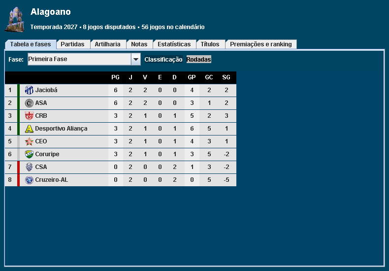

# Brasfoot Windows — mod de competições

Mod para **Brasfoot 2022–2023 no Windows**, com Mundial de Clubes de 32 times, nova Copa Intercontinental e uma aba de Tabelas padronizada para todas as competições.

O jogo mantém seu motor original. Este repositório contém o código do patch e as ferramentas de preparação; **cada pessoa precisa fornecer seu próprio instalador compatível do Brasfoot**.

## O que muda no jogo

| Modificação | Como funciona |
| --- | --- |
| Mundial de Clubes | 32 clubes, oito grupos de quatro e mata-mata das oitavas à final. Começa em 2025 e acontece a cada quatro anos: 2029, 2033… |
| Classificação ao Mundial | Vagas por confederação, campeões continentais e ranking pelos resultados da carreira. A edição de 2025 usa também cinco campeões de 2021 como classificados iniciais. |
| Copa Intercontinental | A partir de 2024, substitui o Mundial anual. Reúne seis campeões continentais em cinco jogos. |
| Novas taças | Mundial, Intercontinental, África–Ásia–Pacífico, Derby das Américas e Challenger Cup, com histórico e galerias. |
| Finanças e rankings | Premiações por participação e avanço, bilheteria e pontos nos rankings de clubes e técnicos para os torneios do mod. |
| Tabelas unificadas | Mesmo painel para nacional, internacional, seleções, estadual e regional: tabela/fases, partidas, artilharia, notas, estatísticas, títulos e premiações. |
| Imagens | Taças com transparência, incluindo a Sul-Minas no formato usado pelo jogo. |

As tabelas usam o renderizador original para preservar fases, escudos e classificação. O Mundial também tem uma aba com os classificados e os critérios das vagas. A premiação detalhada está disponível nos torneios do mod; os demais campeonatos continuam com as regras financeiras originais.



## Instalar no Windows

### 1. Instale os requisitos

- [Git para Windows](https://git-scm.com/downloads/win), para clonar e atualizar.
- [Python 3.9 ou superior](https://www.python.org/downloads/windows/), com o comando **python no PATH**.
- [JDK 21](https://adoptium.net/temurin/releases/?version=21&os=windows&arch=x64), incluindo **java e javac**. No instalador, habilite **JAVA_HOME** e **Add to PATH**. Java 8 ou apenas o JRE não bastam.
- [7-Zip](https://www.7-zip.org/download.html), instalado na pasta padrão `C:\Program Files\7-Zip` ou com `7z.exe` no PATH.
- Seu instalador original do **Brasfoot 2022–2023**.

Não é necessário instalar pacotes com pip, Wine ou um decompilador. A preparação extrai o instalador sem executá-lo e usa as bibliotecas que já vêm com o jogo.

### 2. Clone o repositório

No GitHub, copie a URL no botão **Code**. Abra o terminal na pasta em que deseja guardar o projeto e execute, substituindo o endereço abaixo pela URL copiada:

```powershell
git clone <URL-DO-REPOSITORIO> Brasfoot-Windows
cd Brasfoot-Windows
```

### 3. Confira os requisitos

Abra **Verificar-Requisitos.cmd**. Se houver erro, corrija a dependência indicada e abra um novo terminal após instalar Java ou Python.

### 4. Prepare o jogo

Copie seu instalador para a raiz do projeto com o nome **brasfoot22-23.exe**. A pasta ficará assim:

```text
Brasfoot-Windows/
  brasfoot22-23.exe
  Preparar-Brasfoot-Mod.cmd
  Jogar-Brasfoot-Mod.cmd
  README.md
  ...
```

Abra **Preparar-Brasfoot-Mod.cmd** e aguarde a mensagem de conclusão. Ele extrai sua cópia do jogo, confere a versão e compila o mod em uma instalação separada.

Para usar um instalador em outra pasta, execute no PowerShell:

```powershell
powershell -NoProfile -ExecutionPolicy Bypass -File .\tools\windows.ps1 -Action Build -Installer "D:\Jogos\brasfoot22-23.exe"
```

A compatibilidade é conferida pelo conteúdo, não pelo nome do EXE. O JAR normalizado precisa ter SHA-256:

```text
7028a8b5f08c02fb10690fdb8c1cc7e2ec4b14f5b3aafe22db78626110794aeb
```

Se o build informar uma versão diferente, essa edição não é suportada pelo patch.

### 5. Jogue

Abra **Jogar-Brasfoot-Mod.cmd**.

Para acompanhar a mudança de formatos, comece uma carreira em **2022**, com **competições internacionais de clubes habilitadas**. A Intercontinental começa em 2024 e o primeiro Mundial de 32 clubes em 2025.

Os requisitos de registro do jogo original continuam aplicáveis.

## Saves e atualizações

Os saves ficam por padrão em `runtime/competitions/game/sav/`. Se você escolher outra pasta nas opções do jogo, essa configuração prevalece.

Para atualizar: salve, feche o jogo, guarde uma cópia dos seus saves e execute:

```powershell
git pull --ff-only
.\Preparar-Brasfoot-Mod.cmd
```

Depois, abra novamente **Jogar-Brasfoot-Mod.cmd**. Saves do mod devem ser abertos com o mod. A migração de qualquer save antigo do Brasfoot original não foi validada.

O projeto está em **beta**. Há testes de regras, persistência e interface, mas eles não substituem jogar todas as temporadas e formatos.

## Problemas comuns

| Mensagem / situação | Como resolver |
| --- | --- |
| Java incorreto ou compilador ausente | Instale o **JDK 21 completo**, configure JAVA_HOME e abra outro terminal. |
| Python não encontrado / abre a Microsoft Store | Instale Python, habilite o PATH e confira os aliases de execução do Windows. |
| 7-Zip não encontrado | Instale na pasta padrão ou adicione a pasta que contém 7z.exe ao PATH. |
| JAR diferente do esperado | O instalador não corresponde à edição suportada. Não remova a verificação de hash. |
| Mod não preparado | Execute Preparar-Brasfoot-Mod.cmd antes de jogar. |
| Mudança ainda não aparece | Salve, feche e reabra pelo atalho do mod; o processo aberto continua com a versão anterior. |
| Competição sem jogos | Confira o ano e a fase: os confrontos aparecem quando forem definidos na carreira. |

## Testes e código

Abra **Testar-Brasfoot-Mod.cmd** para validar as regras, executar os testes controlados e verificar a integridade do JAR.

```text
mod/src/mod/       Código Java do mod e da interface
mod/test/mod/      Testes de integração
mod/assets/        Imagens usadas pelo patch
patches/           Configurações das competições e premiações
tools/             Extração, compilação, validação e execução
docs/              Documentação e captura de tela
```

`artifacts/`, `runtime/`, `analysis/` e `.tools/` são locais e ficam fora do Git. O repositório não inclui o EXE, JARs do jogo, saves, ferramentas Java ou arquivos decompilados.

Veja [CONTRIBUTING.md](CONTRIBUTING.md) para contribuir e [docs/desenvolvimento.md](docs/desenvolvimento.md) para detalhes de build e testes.

## Origem e licença

O código do mod usa [GPL-3.0-only](LICENSE). Brasfoot e materiais de terceiros mantêm seus respectivos direitos e não são abrangidos pela licença do código; veja [NOTICE.md](NOTICE.md).
